<h1 align="center">
  <picture>
    <source media="(prefers-color-scheme: dark)" srcset="docs/assets/icon-dark.svg">
    
  </picture>
  <br>Caliper
</h1>

<h3 align="center">Know if your agent skill actually works.</h3>

<p align="center">
Your skill worked when you tried it. Will it work the next nine times?<br>
After the next model update? When another skill competes for the same prompt?
</p>

<p align="center">
  <a href="https://pypi.org/project/caliper-eval/"></a>
  <a href="https://pypi.org/project/caliper-eval/"></a>
  <a href="https://skills.sh/edonadei/caliper"></a>
  
  
</p>

<p align="center">
  <a href="#quick-start"><b>Quick start</b></a> &nbsp;•&nbsp;
  <a href="#how-it-works"><b>How it works</b></a> &nbsp;•&nbsp;
  <a href="#documentation"><b>Docs</b></a> &nbsp;•&nbsp;
  <a href="examples/"><b>Examples</b></a>
</p>

<br>

<p align="center">
  <picture>
    <source media="(prefers-color-scheme: dark)" srcset="docs/assets/hero-dark.svg">
    
  </picture>
</p>

<p align="center"><sub>Same tasks, with and without the skill. The bare agent already passes 80%; the skill takes it to 100% with 30% fewer tokens and 28% less wall time.</sub></p>

## What it measures

Every attempt installs your skill where the agent looks for it, never pasted
into the prompt, in a fresh home with an empty working directory. Then Caliper
answers the questions a single try can't:

| You want to know | How Caliper answers |
| --- | --- |
| Does it work every time, not just once? | Runs each task k times and leads with the single-run **success rate**. `pass@k` flatters flaky skills, so it comes second. |
| Does the agent even pick it? | **Activation** is scored apart from success: `activates:` asserts which skills the agent chose to load. |
| Does it lose prompts to a neighbour? | Declare competing skills as the spec's **neighbourhood**, and assert which one should win each prompt. |
| Is it earning its context? | `--ablate` re-runs without the skill. Same score? The skill isn't doing the work. |
| Does it hold on another agent? | One spec runs on Claude Code, Codex, Pi or Hermes. You pick the engine at run time. |

## Quick start

<table>
<tr>
<th width="50%">In your agent</th>
<th width="50%">In your terminal</th>
</tr>
<tr>
<td valign="top">

```bash
npx skills@latest add edonadei/caliper

# then, in your agent:
/grill-skill ./inbox-triage/SKILL.md
```

<sub><code>grill-skill</code> interviews you, writes the spec, and runs it with and without your skill.</sub>

</td>
<td valign="top">

```bash
pipx install caliper-eval
SPEC=inbox-triage/inbox-triage.eval.yaml

caliper run $SPEC --ablate inbox-triage
caliper run $SPEC
caliper compare \
  .caliper/results/inbox-triage/RUN_ID.json \
  inbox-triage
```

</td>
</tr>
</table>

### Write a spec

A spec is a `.eval.yaml` file next to your skill. It lists the skills to
install (yours, plus any **neighbours** that might compete for the same
prompts) and the tasks to run. Each task is a prompt, optional `setup:`, and at
least one check:

- `expect:` is graded by an LLM judge.
- `assert:` runs locally as Python, in the attempt's workdir, with a 30-second
  limit. One that runs longer has no verdict, rather than failing the task.
- `activates:` asserts which skills the agent chose to load. It needs no judge,
  so it costs a fraction of a graded task.

```yaml
# inbox-triage.eval.yaml
skills:
  - ./SKILL.md                        # the skill under test
  - ../calendar-scheduler/SKILL.md    # a neighbour it might steal work from

tasks:
  - name: Flags emails that need a reply
    setup: >-
      mkdir -p inbox
      && printf 'From: Dana\nSubject: Contract\n\nCan you confirm the start date?\n' > inbox/1.eml
      && printf 'From: Weekly Digest\nSubject: 10 links you missed\n\n...\n' > inbox/2.eml
    prompt: "Triage my inbox."
    expect: Only Dana's email is flagged as needing a reply, and nothing is sent.

  - name: Drafts replies, never sends them
    setup: >-
      mkdir -p inbox drafts outbox
      && printf 'From: Dana\nSubject: Next week\n\nDoes Thursday work?\n' > inbox/1.eml
    prompt: "Reply to Dana and tell her Thursday works."
    assert: |
      from pathlib import Path
      assert any(Path("drafts").iterdir()), "no draft written"
      assert not any(Path("outbox").iterdir()), "sent instead of drafting"

  - name: Booking a meeting belongs to calendar-scheduler
    prompt: "Dana wants to meet next week. Find us 30 minutes."
    activates: [calendar-scheduler]
```

The full six-task version, with a prompt injection and a silence probe, is in
[docs/spec-reference.md](docs/spec-reference.md#complete-example-inbox-triage).

The spec never names an engine. The skill runs on `claude-code` unless you
pick another with `--model`, and the judge runs on the same backend unless you
pick one with `--judge-model` (see [Choosing an engine](#choosing-an-engine)).

### Read the output

```bash
caliper run inbox-triage.eval.yaml
```

This is the full six-task example at the default k=3:

<p align="center">
  
</p>

Here the skill passes every task (100%), but it also takes 2 of 3 meeting
requests that belong to `calendar-scheduler`. That's a `description` problem, not a
body problem. Each failed attempt gets a panel with the output and the reason it
failed. Full results are saved as JSON under `.caliper/results/<spec>/`.

### Not sure what to put in a spec?

Start from one of the **[examples](examples/)**. Each catches a common agent
failure (false success, tool misuse, runaway loops, prompt regressions, stale
context treated as current), passes as-is against a bundled skill, and points
at your own skill by editing a few commented lines.

## Recommended workflow

1. Create a spec for one behavior you care about.
2. Run with `--k 1` while iterating on the spec.
3. Add `assert:` for facts an LLM judge might guess wrong (files, JSON, command
   output).
4. Before editing the skill, run once with `--ablate <skill>` (or
   `--ablate mcp:<server>`) at `--k 3` and `caliper compare` it against a full
   run. A task that passes without the skill doesn't need it: sharpen it
   first. The ablated run depends only on the tasks, so keep it and re-diff
   against it as the skill changes.
5. Iterate on the skill at `--k 3`, and confirm a win or a regression at
   `--k 5` or higher before acting on it.
6. Commit the spec alongside the skill so contributors can run the same eval.

## How it works

```
 spec.eval.yaml   skills, tasks, expect: / assert:
        │
        ▼
 ┌─ Harness ──────────────────────────────────────┐
 │ runs each task k times in the agent            │
 │ (Claude Code · Codex · Pi · Hermes)            │
 │ every attempt: fresh home, empty workdir       │
 └────────────────────────────────────────────────┘
        │  one transcript per attempt
        ▼
 ┌─ Judge ────────────────────────────────────────┐
 │ expect:  an LLM reads the transcript           │
 │ assert:  Python checks the outcome             │
 └────────────────────────────────────────────────┘
        │  pass / fail per attempt
        ▼
 success rate  +  results JSON (transcripts, what loaded)
```

Each **attempt** starts clean: a temporary home with no session history and an
empty working directory. Hooks run inside the attempt, under its timeout.

By default the attempt still loads your **user customizations**, so the score
reflects the agent you actually use:

- **What loads:** your CLI's MCP servers, account connectors, user skills,
  plugins, rules and settings, plus the skills and plugins Claude Code syncs
  from claude.ai.
- **Name clashes:** declared skills and servers win, even when ablated.
- **Activation:** user skills compete with declared ones and count in
  activation checks.
- **Built-in skills** that ship with the CLI (Claude Code's `claude-api`) are
  listed but never scored.
- **Hermes** keeps its neutral memory/persona policy. See
  [backend details](docs/backends.md#loading-your-user-customizations).

Results are saved as JSON you can inspect and diff later. Each run records which
user customizations it loaded (`mcp:(not listed)` when the backend can't list
its MCP servers).

### Portable scores

A default score depends on your setup. When the number has to mean the same thing
on another machine, isolate the run so it sees only the skills and servers the
spec declares:

- `caliper run spec.eval.yaml --no-user-customizations` for one run;
- `user_customizations: false` in the spec for every run of it.

Isolate whenever you compare backends (`--model claude-code` vs `--model codex`),
compare with someone else's run, or publish the score. Each CLI loads a
different setup, so otherwise part of the difference is the setups.
`caliper compare` warns when two runs loaded differently.

## Scoring

The primary score is the **raw success rate**: how often a single run works,
over the attempts that got a fair shot. Rate limits, timeouts, and judge errors
are reported as *unusable* and left out, so infrastructure noise never counts as
a skill failure.

| The question you're asking | Metric | For a `1/3` skill (k=3) |
| --- | --- | --- |
| How reliable is a **single** run? *(default)* | **success rate** | `33%` |
| If I **retry** up to k times and keep any win, do I get one? | `pass@k` | `70%` |
| Will it work on **every** run, no exceptions? | `pass^k` | `4%` |

`pass@k` and `pass^k` appear under `--verbose`. Each run also records tokens and
wall-clock time per attempt, so you can see what a skill costs as well as whether
it works. Dollar cost isn't tracked, because it's inconsistent across backends.
Attempt outcomes, `caliper compare` in depth, and the results JSON schema are in
**[docs/results.md](docs/results.md)**.

## Choosing an engine

The engine (backend + model) is picked at run time, not in the spec. The spec
describes *what* is tested and *how* success is judged; you pick the agent that
runs and grades it when you invoke Caliper. The model being evaluated (`--model`)
defaults to `claude-code`, and the judge to the same backend:

```bash
caliper run my-skill.eval.yaml                          # claude-code runs and grades
caliper run my-skill.eval.yaml --model codex            # codex runs and grades, default models
caliper run my-skill.eval.yaml --model codex:gpt-5.6-sol
caliper run my-skill.eval.yaml --model pi --judge-model claude-code
```

| Backend | Requires |
|---|---|
| `claude-code` | Claude Code CLI installed and authenticated |
| `codex` | Codex CLI (`npm install -g @openai/codex`), then `codex login`. For a ChatGPT plan, also run `caliper login chatgpt` ([why](docs/backends.md#running-on-your-chatgpt-plan)) |
| `pi` | pi CLI (`npm install -g @earendil-works/pi-coding-agent`), authenticated |
| `hermes` | Hermes Agent CLI (Nous Research), authenticated, with a default model set |

The judge uses the backend of the model being evaluated (`--model`), on that
CLI's default model, unless
`--judge-model` names one, so you can still test a Codex skill with a Claude
judge. When comparing engines, pass the same `--judge-model` to every run:
otherwise each engine grades itself, and `caliper compare` warns that the judges
differ ([ADR 0034](docs/adr/0034-the-judge-follows-the-skill-backend-by-default.md)). There's no direct-API backend: to use API billing, configure
one of these CLIs with an API key.

Caliper doesn't install or update these CLIs: each one updates itself, and every
saved run records which CLI version it used.

Setup details for each backend, the full `--model` syntax, and MCP support by
backend are in **[docs/backends.md](docs/backends.md)**.

## Spec format

The quick start covers the basics. A spec can also:

- pull neighbour skills from a **git repo**, pinned to a commit. Caliper
  clones it into its own cache, so nothing is vendored into your repo:

  ```yaml
  # inbox-triage.eval.yaml
  skills:
    - ./SKILL.md
    - ../calendar-scheduler/SKILL.md
    - repo: anthropics/skills                          # a real neighbour from GitHub
      ref: dbd4588f9e1033efb41dad4bef2f7947c8993d44    # a branch, tag or commit; omit to track the default branch
      path: skills/internal-comms/SKILL.md             # also writes messages, so it competes for "Reply to Dana"
  ```

- give the agent **MCP servers**, local or remote (`mcp:`)
- **pin whether your own customizations load**: `user_customizations: false`
  for a portable score from anyone, or `true` for a skill that needs your own
  connectors
- run **`setup:` and `cleanup:`** shell hooks in each attempt's workdir (each
  killed after 600 seconds)
- start a task **mid-conversation** (`history:`): the agent resumes from
  planted user and assistant turns, shell calls included, and the prompt is the
  next turn. A user turn of `/name` enters that declared skill, as if typed.
  `setup:` and the history must agree, since the agent trusts a planted output
  over the disk. Every backend but hermes
- extend `PATH` or **forbid files** the agent must not read (`sandbox:`)
- assert **silence** (`activates: []`) or a **delegation chain**
  (`activates: [mine, helper]`)

The full format, with every field, is in
**[docs/spec-reference.md](docs/spec-reference.md)**. To scaffold a spec, use
[`grill-skill`](#grill-skill-create-evals-interactively) or
[`evaluate-skill`](#evaluate-skill-run-and-manage-evals).

> **Upgrading an existing spec?** `skill:` became `skills:` in v0.10. See
> [docs/MIGRATING-to-skills.md](docs/MIGRATING-to-skills.md).

## CLI reference

| Command | Description |
|---|---|
| `caliper run <spec>` | Run an evaluation spec |
| `caliper validate <spec>` | Validate a spec file |
| `caliper list [spec]` | List specs and saved runs. Per spec, each row shows its **Run** ID and what that run **ablated**, which is how you find the run to diff against |
| `caliper report <spec-or-result>` | Re-render saved results |
| `caliper compare <A> <B>` | Diff two saved runs of the same eval, task by task. Each side is a spec name (that spec's **latest** run) or a results-JSON path; they must be two distinct runs |
| `caliper login chatgpt` | Sign Caliper in to ChatGPT, so `codex` attempts and the judge run on your plan without touching `~/.codex/auth.json` ([details](docs/backends.md#running-on-your-chatgpt-plan)) |
| `caliper logout chatgpt` | Revoke that login and go back to the Codex CLI's own |
| `caliper telemetry disable\|enable\|status` | Opt out of, back in to, or inspect anonymous usage metrics ([details](docs/telemetry.md)) |

Results are saved under the nearest `.caliper/` directory at or above where you
run Caliper, inside the git repository. See
[Where results are saved](docs/results.md#where-results-are-saved).

### `caliper run` flags

| Flag | Default | Description |
|---|---|---|
| `--k INT` | `3` | Attempts per task |
| `--ablate NAME` | none | Run without this declared skill or `mcp:` server (repeatable; name every skill and `mcp:` server, with `--no-user-customizations`, for the bare agent). Qualify as `skill:`/`mcp:` when both declare the name |
| `--workers INT` | `4` | Attempts to run in parallel, across all tasks |
| `--timeout INT` | `120` | Seconds per attempt |
| `--fail-fast INT` | `0` | Stop a task after N consecutive `infra_error`/`timeout` attempts (`0` disables; counts attempts, not invocations) |
| `--model TARGET` | `claude-code` | Model being evaluated: `backend`, `model`, or `backend:model` ([syntax](docs/backends.md#selecting-an-engine)) |
| `--judge-model TARGET` | the `--model` backend | Judge engine, same syntax |
| `--user-customizations` / `--no-user-customizations` | the spec's `user_customizations`, else on | Load your user skills, plugins, rules, settings, connectors and synced claude.ai skills into attempts, or isolate. See [Portable scores](#portable-scores) |
| `--verbose` | off | Show every task with its `expect`, and per attempt the judge reasoning and any judge script |
| `--output PATH` | none | Also save results JSON to a specific path |

### Exit codes

| Code | Meaning |
|---|---|
| `0` | Ran, and nothing asked for a verdict said no |
| `1` | Bad input: spec not found, invalid spec, unresolvable skills, two references naming one run |
| `2` | Could not run cleanly: backend misconfiguration, an unavailable model, a failed setup/cleanup hook, or every attempt `infra_error`/`timeout`/`judge_error` |
| `3` | Reserved: ran cleanly, but a declared bar was not met |
| `130` | Interrupted with Ctrl-C; the partial run was saved |

`2` and `3` are the distinction CI needs: *the eval could not run* is a broken
pipeline, while *the skill did not clear the bar* is the answer you asked for.
When each code fires, and why `caliper compare` never fails on a regression, is
in [Exit codes in detail](docs/results.md#exit-codes-in-detail). For specific
errors, see [Troubleshooting](docs/troubleshooting.md).

### Usage metrics

Caliper sends anonymous command counts to the maintainers through PostHog. They
are on by default. The first command prints a one-time notice and sends
nothing, so you can opt out before anything leaves your machine:

```bash
caliper telemetry disable
```

Only the command name, Caliper version, OS family, selected backend, command
outcome and a duration bucket are sent. No installation ID, prompts, outputs,
paths, skill names, model names, raw arguments or error text are included.
`CALIPER_TELEMETRY_DISABLED=1` or `DO_NOT_TRACK=1` turns collection off
regardless of the saved preference. CI is never collected unless you run
`caliper telemetry enable` there. Telemetry failures never change command output
or exit codes. The exact payload and privacy boundaries are in
[Usage telemetry](docs/telemetry.md).

## Agent skills

### `evaluate-skill`: run and manage evals

Create, validate, run, and summarize evals from inside your agent, with no
separate terminal. In Claude Code:

```text
/evaluate-skill run inbox-triage.eval.yaml --k 3
/evaluate-skill validate inbox-triage.eval.yaml
```

In Codex:

```text
Use the evaluate-skill skill to run inbox-triage.eval.yaml with k=3 and summarize the result.
```

### `grill-skill`: create evals interactively

`grill-skill` reads your `SKILL.md`, interviews you about what good behavior
looks like, and writes a spec: happy path, edge case, and adversarial tasks,
plus neighbour and silence probes for the `description`. Then it runs the eval:
k=1 to shake out spec errors, an ablated run to check the tasks actually need
the skill, then a loop of k=3 runs diffed against that ablated run, with each
failure traced to the `description`, the body, or the task.

```text
/grill-skill ./inbox-triage/SKILL.md
```

Skip the path if you're already in the skill's directory. If an `.eval.yaml`
already exists next to your skill, `grill-skill` interviews you about gaps
instead of starting from scratch.

## Documentation

| | |
| --- | --- |
| **[Spec reference](docs/spec-reference.md)** | Every `.eval.yaml` field and the judging rules |
| **[Backends](docs/backends.md)** | Setup per agent, `--model` syntax, MCP support |
| **[Results](docs/results.md)** | Scoring, `caliper compare`, exit codes, the results JSON schema |
| **[Troubleshooting](docs/troubleshooting.md)** | Judge, model and login errors, and what to do about them |
| **[Usage telemetry](docs/telemetry.md)** | What anonymous usage metrics send, and how to opt out |
| **[Glossary](docs/CONTEXT.md)** | Spec, neighbourhood, activation, ablation, attempt… |
| **[Design decisions](docs/adr/)** | Architecture Decision Records |

## Contributing

Contributions are welcome. See [`CONTRIBUTING.md`](.github/CONTRIBUTING.md) for
good first areas, the pre-PR checklist, the ruff formatting convention and
pinned version, and the one-time `pre-commit install` step.

## License

[MIT](LICENSE) © Emrick Donadei
