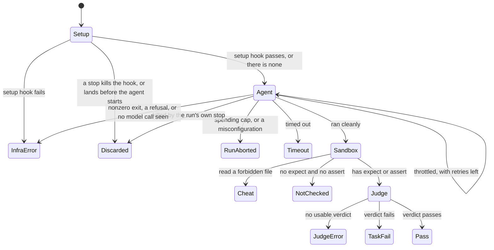
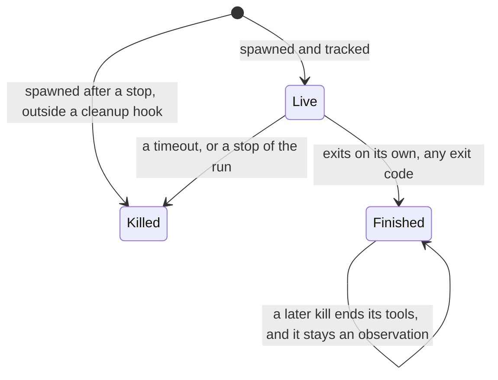
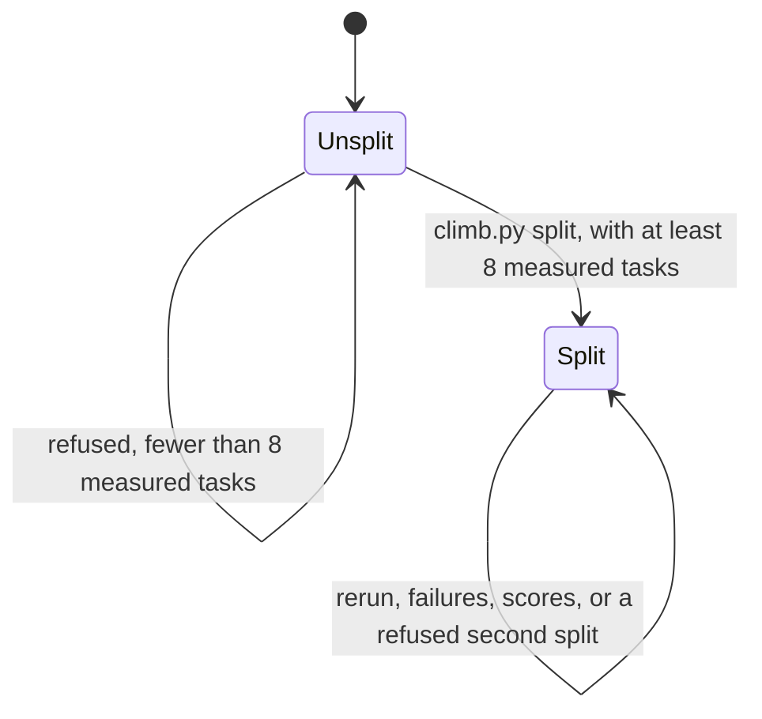

# State machines

Three parts of Caliper are state machines whose order matters more than any one
step. Each chart below is checked: `tests/test_state_machines.py` runs it as a
Hypothesis rule-based machine against the real code, and fails if a chart's
edges differ from the ones that machine moves along.

## How an attempt ends

`caliper/attempt.py` grades an attempt by trying these exits in order, and the
first one that holds decides the [outcome](CONTEXT.md#outcome). Several can
hold at once: an attempt can time out *and* read a forbidden file, and it ends
as `Timeout`.

- Only the three states after `Judge` cost a judge call. Every earlier exit
  skips it, so an attempt that never got a fair shot spends nothing on grading
  ([ADR 0001](adr/0001-attempt-outcome-taxonomy.md)).
- `Discarded` is no record at all: the interrupt isn't an observation about the
  skill ([ADR 0018](adr/0018-the-attempt-is-the-unit-of-parallelism.md)). An
  attempt that failed on its own while the run was stopping is kept.
- A throttle that outlasts its retries, or that a stop cuts short during the
  wait, leaves the refusal on the result and ends as `InfraError`
  ([ADR 0019](adr/0019-an-attempt-may-be-invoked-more-than-once.md)).
- After `Timeout` or `InfraError`, a skill seen loading before the cut is still
  recorded, but seeing none records nothing rather than a miss, and neither is
  graded ([activation admissibility](CONTEXT.md#activation-admissibility)).
- `RunAborted` stops the whole run, which still saves the attempts it already
  paid for.

## A tracked agent process

`caliper/cancel.py` registers every agent process while it runs, so a stop can
reach it. A kill also reaches the tools the agent started, even after the agent
exits and leaves them behind. An agent that comes back after a stop killed it
is discarded, not recorded. A timeout kills through the same module, but that
attempt is kept as `Timeout`.

When tracking ends, the process leaves every registry (`_live`, `_descendants`,
`_tags`), whatever state it ended in, and `was_killed` still answers for it.

## A hillclimb's held-out tasks

`skills/hillclimb-skill/climb.py` fixes a train / held-out split once, then
answers the climber's questions about the train tasks only.

From `Split`, no command shows a held-out task's prompt, `expect:`, verdict or
transcript, and `failures --task` refuses a held-out name. A held-out task
counts only toward the held-out score that `scores` prints.
